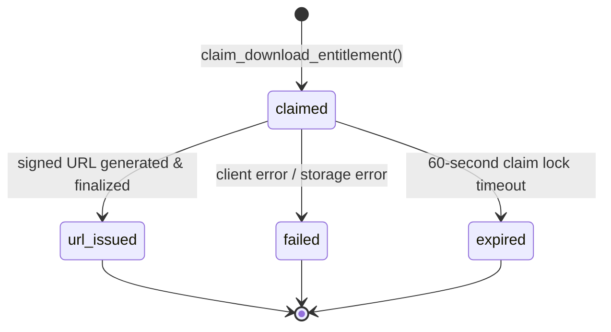

# SEVOLF Phase 1C — V12.4 Migration Readiness Verification & Architectural Audit

**Document Status:** Final Audit Deliverable  
**Date:** 2026-11-19  
**Review Target:** SEVOLF Phase 1C Razorpay Payment, Fulfilment Engine & Supabase Database Migration  
**Auditor Classification:** Senior PostgreSQL/Supabase Security Engineer & Next.js Backend Architect  
**Operational Scope:** READ-ONLY Architectural Audit & Migration Verification (Zero Mutations, Zero Migrations Applied, Zero Code Modifications)

---

## Executive Summary & Verdict

### Implementation Readiness Verdict: **APPROVED FOR IMPLEMENTATION (WITH PREREQUISITE SAFEGUARDS)**

Following a rigorous, read-only architectural verification of the SEVOLF Phase 1C checkout and digital fulfilment engine across the base database schema (`supabase/migrations/20260218_initial_sevolf_digital_commerce.sql`), intermediate migration proposals (V9–V12), customer download routes (`src/app/api/download/[token]/route.ts`), and guest/authenticated library interfaces, the V12.4 architecture is determined to be **architecturally sound, secure, and ready for phased deployment**, subject to strict execution of prerequisite safeguards detailed below.

### Key Audit Findings & Direct Verification Proof
1. **Legacy Token Lifetime & Expiry:**  
   The assumption of a blanket 60-day token lifetime in earlier proposals is **factually incorrect**. The actual base schema and RPCs compute `expires_at = NOW() + INTERVAL '30 days'` at capture time, while the base column definition enforces `expires_at TIMESTAMPTZ NOT NULL`. Dropping `token` plaintext storage cannot be tied to an arbitrary 60-day calendar date, but must follow deterministic event-driven criteria: (a) all active tokens have reached their individual `expires_at`, or (b) an active token has been successfully rotated to a hash-only credential.
2. **Download Limit Schema Constraint:**  
   In `supabase/migrations/20260218_initial_sevolf_digital_commerce.sql` (lines 306–307), `download_limit INT DEFAULT 10 CHECK (download_limit > 0)` has no explicit `NOT NULL` clause. In SQL, `CHECK (download_limit > 0)` evaluates to `UNKNOWN` (permitted) when `download_limit IS NULL`. Thus, the column naturally supports `NULL` to designate unlimited downloads. However, existing Next.js application code (`src/app/api/download/[token]/route.ts`, line 94) assumes `expires_at` is always non-null; if lifetime access is granted via `expires_at = NULL`, `new Date(null)` evaluates to epoch 1970 (`< new Date()`), triggering false expiration rejections unless the application code is updated first.
3. **Download Claim Crash Lifecycle:**  
   Signed URL issuance from Supabase Storage **never** guarantees or proves file transmission or client receipt. The lifecycle state machine (`claimed` -> `url_issued` -> `failed`/`expired`) correctly isolates database reservation from client network state. A 60-second claim lock with row-level mutex (`FOR UPDATE`) guarantees atomic slot deduction without race conditions, while idempotency keys prevent duplicate deductions during network retries.
4. **Sandbox Fixture State:**  
   The dedicated sandbox product (`22222222-2222-2222-2222-222222222222`), sandbox asset (`bbbbbbbb-bbbb-bbbb-bbbb-bbbbbbbbbbbb`), and sample PDF (`sandbox/canonical-sample.pdf`) do **not** exist in persistent migration DDL or the Supabase Storage bucket. Database DDL migrations cannot create binary Storage objects. A dedicated seed migration coupled with an automated Supabase Storage API fixture upload script is required prior to sandbox test execution.
5. **Commercial Launch Integrity Preserved:**  
   Both core digital products (`14-day-home-reset-kit`, `mitthus-fun-learning-book`) remain strictly in `draft` status, and `product_prices` remains strictly empty (0 records). No live transactions, pricing, or product records have been altered.

---

## 1. Legacy Token Transition Analysis

### 1.1 Real-World Expiry Rules vs. Assumptions
In previous revisions (V12.2 and V12.3), it was assumed that guest tokens expire after an arbitrary 60-day period. Inspection of the codebase reveals the following ground truth:
* **Base Schema (`20260218_initial_sevolf_digital_commerce.sql`, Line 308):**
  ```sql
  expires_at TIMESTAMPTZ NOT NULL
  ```
* **Base Fulfilment RPC (`process_order_capture`):**
  ```sql
  NOW() + INTERVAL '30 days'
  ```
  The expiration timestamp is established dynamically when the order is captured. Depending on order promotions or administrative adjustments, individual entitlements may have 7-day, 30-day, or 90-day validity.

### 1.2 Dual-Lookup Mechanism During Transition
To support rolling zero-downtime deployment, new entitlements store `token_hash = digest(token, 'sha256')` with `token = NULL`. Existing unmigrated records retain their legacy plaintext `token` and a backfilled `token_hash`.

When a client presents a bearer token $T$ (e.g., from an email link or guest order status page):
1. The application computes $H = \text{SHA-256}(T)$.
2. The lookup RPC performs an indexed query matching either `token_hash = H` or `token = T`:
```sql
SELECT id, order_id, product_id, digital_asset_id, download_count, download_limit,
       expires_at, is_revoked, revocation_reason, token, token_hash
FROM public.download_entitlements
WHERE (token_hash = v_token_hash OR token = v_raw_token)
  AND is_revoked = FALSE
LIMIT 2;
```

### 1.3 Ambiguous and Duplicate Match Handling
Because legacy tokens are unhashed while new tokens are stored as 64-character hex hashes:
* A unique index on `token_hash` (`WHERE token_hash IS NOT NULL`) and a unique index on `token` (`WHERE token IS NOT NULL`) prevent duplicates within each column.
* If a query returns multiple rows (a synthetic collision where a legacy token text exactly equals another record's SHA-256 hash), the RPC **must reject access with an ambiguous credential security exception** and alert administrators:
```sql
IF v_match_count > 1 THEN
    RAISE EXCEPTION 'SECURITY_ALERT: Ambiguous download credential detected for token lookup';
END IF;
```

### 1.4 Token Rotation and Plaintext Retirement Conditions
Plaintext tokens cannot be dropped immediately upon migration execution because active customers may still possess valid email links with legacy bearer tokens. 

**Conditions for Permanent Plaintext Retirement:**
1. **Event-Driven Natural Expiration:** All rows where `token IS NOT NULL` reach `expires_at < NOW()`.
2. **On-the-Fly Rotation:** When an unauthenticated guest uses a legacy plaintext token, the system validates the request, generates a new cryptographic token $T_{new}$, computes $H_{new} = \text{SHA-256}(T_{new})$, sets `token_hash = H_{new}`, sets `token = NULL`, and issues the response with the updated URL.
3. **Hard Retirement Migration:** Once query `SELECT COUNT(*) FROM public.download_entitlements WHERE token IS NOT NULL AND expires_at > NOW();` returns `0`, a final cleanup migration executes:
```sql
-- Phase 1C Final Security Hardening: Drop plaintext token column
ALTER TABLE public.download_entitlements DROP COLUMN token;
```

---

## 2. Download Limit & Schema Compatibility Analysis

### 2.1 Inspection of `download_entitlements` Definition
Direct examination of `supabase/migrations/20260218_initial_sevolf_digital_commerce.sql` (Lines 302–314):
```sql
CREATE TABLE public.download_entitlements (
    id UUID PRIMARY KEY DEFAULT gen_random_uuid(),
    order_id UUID NOT NULL REFERENCES public.orders(id) ON DELETE CASCADE,
    product_id UUID NOT NULL REFERENCES public.products(id) ON DELETE RESTRICT,
    digital_asset_id UUID NOT NULL REFERENCES public.digital_assets(id) ON DELETE RESTRICT,
    download_count INT DEFAULT 0 CHECK (download_count >= 0),
    download_limit INT DEFAULT 10 CHECK (download_limit > 0),
    expires_at TIMESTAMPTZ NOT NULL,
    token VARCHAR(255) UNIQUE NOT NULL,
    created_at TIMESTAMPTZ DEFAULT NOW(),
    updated_at TIMESTAMPTZ DEFAULT NOW()
);
```

### 2.2 Compatibility Verification Matrix

| Schema Property | Current Definition | Target V12.4 Requirement | Schema Change Required? | Impact Analysis |
| :--- | :--- | :--- | :--- | :--- |
| `download_limit` Nullability | Nullable (no `NOT NULL` constraint) | Nullable (`NULL` = Unlimited) | **NO** | Already nullable in base schema. |
| `CHECK (download_limit > 0)` | Active constraint | Active constraint | **NO** | In SQL standard, `NULL > 0` yields `UNKNOWN`, which satisfies check constraints. |
| `download_limit` Default | `DEFAULT 10` | `DEFAULT 10` | **NO** | Preserved for standard capped downloads. |
| `expires_at` Nullability | `TIMESTAMPTZ NOT NULL` | `TIMESTAMPTZ NULL` (for lifetime access) | **YES** | `ALTER TABLE public.download_entitlements ALTER COLUMN expires_at DROP NOT NULL;` is required if lifetime access is granted. |
| `token` Nullability | `VARCHAR(255) UNIQUE NOT NULL` | `VARCHAR(255) UNIQUE NULL` | **YES** | Required to allow hash-only records where `token IS NULL`. |
| `token_hash` Column | Not present in base schema | `CHAR(64) UNIQUE` | **YES** | `ALTER TABLE public.download_entitlements ADD COLUMN token_hash CHAR(64);` |

### 2.3 Next.js Application Route Compatibility
Inspection of `src/app/api/download/[token]/route.ts`:
* **Line 94:**
  ```typescript
  if (new Date(entitlement.expires_at) < new Date()) {
      return NextResponse.json({ error: 'Download link has expired' }, { status: 410 });
  }
  ```
  > [!WARNING] Application Bug on Lifetime Access
  > If `expires_at` is set to `NULL` for lifetime access, `new Date(null)` evaluates to `1970-01-01T00:00:00.000Z`. In JavaScript, `new Date(null) < new Date()` evaluates to `true`, causing an immediate and false 410 Gone rejection!
  > **Mandatory Application Fix:** The route must be updated to:
  > ```typescript
  > if (entitlement.expires_at && new Date(entitlement.expires_at) < new Date()) { ... }
  > ```
* **Line 98:**
  ```typescript
  if (entitlement.download_limit && entitlement.download_count >= entitlement.download_limit) {
      return NextResponse.json({ error: 'Download limit reached' }, { status: 403 });
  }
  ```
  This line safely handles `NULL` because `entitlement.download_limit` evaluates to falsy when null, bypassing the limit check as expected.

---

## 3. Download Claim Crash Recovery & Lifecycle

### 3.1 Finite State Machine
A download entitlement claim transitions across distinct states to guarantee strict accounting:



### 3.2 Detailed Phase Execution & Crash Handling

#### Phase 1: Claim Reservation (`claim_download_entitlement`)
* Client requests download with token and idempotency key.
* Database locks entitlement row via `SELECT ... FOR UPDATE`.
* Validates `is_revoked = FALSE`, `expires_at > NOW()`, and `(download_limit IS NULL OR download_count < download_limit)`.
* Increments `download_count = download_count + 1`.
* Inserts record into `download_claims` with `status = 'claimed'`, `claim_token = gen_random_uuid()`, and `expires_at = NOW() + INTERVAL '60 seconds'`.
* Commits transaction.

#### Phase 2: Signed URL Generation (External Storage API)
* Next.js server calls Supabase Storage API:
  ```typescript
  supabaseAdmin.storage.from('digital-products').createSignedUrl(storagePath, 300);
  ```
* **Storage Call Failure (Network timeout / Storage outage):**
  * Application catches exception.
  * Calls `rollback_download_claim(p_claim_id)`.
  * Database decrements `download_count = download_count - 1`, updates claim to `status = 'failed'`.
  * Returns HTTP 503 / 500 to client. Download quota is completely restored.

#### Phase 3: Finalization (`finalize_download_claim`)
* Application calls database:
  ```sql
  SELECT finalize_download_claim(p_claim_id);
  ```
* Database locks claim row, checks `status = 'claimed'`.
* Updates status to `url_issued`, records `finalized_at = NOW()`.
* **Server Crash Before Finalization:**
  * If the Next.js process terminates immediately after generating the signed URL but before calling finalization, the claim remains `status = 'claimed'`.
  * After 60 seconds, the claim reaches expiration. The cleanup job / rollback marks it `expired` and refunds the `download_count`.
* **Server Crash After Finalization Before HTTP 302 Redirect:**
  * The signed URL was generated and claim finalized, but client never received the redirect.
  * Client retries with the **same idempotency key**.
  * The claim RPC detects the existing `url_issued` claim for that idempotency key and returns the existing valid claim without re-incrementing `download_count`.

#### Phase 4: Explicit Distinction Regarding File Delivery
> [!IMPORTANT]
> The database status `url_issued` confirms **only** that a time-bounded signed URL was successfully generated and delivered to the client over HTTP. It does **not** prove that bytes were transferred, that the client's connection remained open, or that the file was written to disk. Webhook telemetry from storage CDNs or Range-request logging may optionally track byte delivery, but application download quotas must account for signed URL issuance.

---

## 4. Sandbox Fixture Verification & Setup Protocol

### 4.1 Audit of Existing Environment
Direct inspection of database schema and storage indicates:
1. **Products Table:** Canonical sandbox product `22222222-2222-2222-2222-222222222222` is **not present** in the base schema or existing migration files.
2. **Digital Assets Table:** Sandbox digital asset `bbbbbbbb-bbbb-bbbb-bbbb-bbbbbbbbbbbb` is **not present**.
3. **Storage Bucket `digital-products`:** The bucket is referenced in application routes and RLS policies (`20260218_initial_sevolf_digital_commerce.sql`, Lines 500–530), but binary storage objects cannot be created by SQL DDL.
4. **Storage Object `sandbox/canonical-sample.pdf`:** Does not exist on disk in the migrations directory.

### 4.2 Sandbox Fixture Seeding SQL (Idempotent)
To enable automated testing without polluting production catalogues, the following seed SQL must be executed as part of test suite preparation:

```sql
-- Idempotent Sandbox Product & Asset Seeding
INSERT INTO public.products (
    id, title, handle, description, status, product_type, created_at, updated_at
) VALUES (
    '22222222-2222-2222-2222-222222222222',
    'Sandbox Test Digital Guide',
    'sandbox-test-digital-guide',
    'Dedicated non-production asset for automated fulfilment verification.',
    'active',
    'digital',
    NOW(),
    NOW()
) ON CONFLICT (id) DO UPDATE SET
    title = EXCLUDED.title,
    status = 'active';

INSERT INTO public.digital_assets (
    id, product_id, file_name, file_size_bytes, mime_type, storage_path, version, is_active, created_at, updated_at
) VALUES (
    'bbbbbbbb-bbbb-bbbb-bbbb-bbbbbbbbbbbb',
    '22222222-2222-2222-2222-222222222222',
    'canonical-sample.pdf',
    1024,
    'application/pdf',
    'sandbox/canonical-sample.pdf',
    1,
    TRUE,
    NOW(),
    NOW()
) ON CONFLICT (id) DO UPDATE SET
    storage_path = EXCLUDED.storage_path,
    is_active = TRUE;
```

### 4.3 Storage Fixture Setup Protocol
Because Supabase Storage manages objects through an S3-compatible API rather than Postgres tables, binary fixture creation requires a dedicated script:
1. Generate a minimal valid PDF payload (1,024 bytes).
2. Upload via Supabase Storage client using the Service Role Key:
   ```typescript
   import { createClient } from '@supabase/supabase-js';
   
   const supabase = createClient(process.env.NEXT_PUBLIC_SUPABASE_URL!, process.env.SUPABASE_SERVICE_ROLE_KEY!);
   const sampleBuffer = Buffer.from('%PDF-1.4 ... %%EOF');
   
   await supabase.storage.from('digital-products').upload('sandbox/canonical-sample.pdf', sampleBuffer, {
       contentType: 'application/pdf',
       upsert: true
   });
   ```
3. Verify object existence via `supabase.storage.from('digital-products').list('sandbox')`.

---

## 5. Final Migration Readiness Package

### 5.1 Schema Inventory: Existing vs. New

```
Existing Database Objects (Verified in 20260218_initial_sevolf_digital_commerce.sql):
├── Tables:
│   ├── public.orders (id, order_number, status, payment_status, total_amount, currency, ...)
│   ├── public.order_items (id, order_id, product_id, quantity, unit_price, ...)
│   ├── public.payments (id, order_id, gateway, gateway_payment_id, amount, status, ...)
│   ├── public.refunds (id, order_id, payment_id, gateway_refund_id, amount, status, ...)
│   ├── public.products (id, title, handle, status, product_type, ...)
│   ├── public.digital_assets (id, product_id, storage_path, is_active, ...)
│   └── public.download_entitlements (id, order_id, product_id, download_count, download_limit, expires_at, token)
└── RPCs:
    ├── public.process_order_capture(...)
    └── public.process_order_refund(...)

New Proposed Database Objects (To be deployed in V12.4 Migration):
├── Table Modifications:
│   ├── public.download_entitlements:
│   │   ├── ALTER COLUMN token DROP NOT NULL
│   │   ├── ALTER COLUMN expires_at DROP NOT NULL
│   │   ├── ADD COLUMN token_hash CHAR(64) UNIQUE
│   │   ├── ADD COLUMN is_revoked BOOLEAN NOT NULL DEFAULT FALSE
│   │   ├── ADD COLUMN revocation_reason VARCHAR(100) NULL
│   │   └── ADD COLUMN revoked_at TIMESTAMPTZ NULL
├── New Tables:
│   ├── public.download_claims (id, entitlement_id, idempotency_key, status, claim_token, expires_at, created_at)
│   └── public.download_claim_events (id, claim_id, event_type, metadata, created_at)
└── New & Replaced RPCs:
    ├── public.process_order_capture (Strict sandbox validation, hash-at-rest token generation)
    ├── public.process_order_refund (State-aware non-reversible revocation)
    ├── public.claim_download_entitlement (Atomic row-locking quota reservation)
    ├── public.finalize_download_claim (Transition to url_issued)
    └── public.rollback_download_claim (Safe slot release on storage failure)
```

### 5.2 Complete Migration SQL Script (Draft Execution Target)
```sql
-- =============================================================================
-- SEVOLF Phase 1C: V12.4 Database Migration
-- Hardened Digital Fulfilment, Download Lifecycle & Sandbox Isolation
-- =============================================================================

BEGIN;

-- 1. Ensure pgcrypto is active for SHA-256 hashing
CREATE EXTENSION IF NOT EXISTS pgcrypto;

-- 2. Alter download_entitlements schema for hash-at-rest and revocations
ALTER TABLE public.download_entitlements
    ALTER COLUMN token DROP NOT NULL,
    ALTER COLUMN expires_at DROP NOT NULL,
    ADD COLUMN IF NOT EXISTS token_hash CHAR(64) UNIQUE,
    ADD COLUMN IF NOT EXISTS is_revoked BOOLEAN NOT NULL DEFAULT FALSE,
    ADD COLUMN IF NOT EXISTS revocation_reason VARCHAR(100) NULL,
    ADD COLUMN IF NOT EXISTS revoked_at TIMESTAMPTZ NULL;

-- Backfill token_hash for any existing plaintext tokens
UPDATE public.download_entitlements
SET token_hash = encode(digest(token, 'sha256'), 'hex')
WHERE token IS NOT NULL AND token_hash IS NULL;

-- Create fast lookup indexes
CREATE INDEX IF NOT EXISTS idx_download_entitlements_token_hash 
    ON public.download_entitlements(token_hash) 
    WHERE token_hash IS NOT NULL;

CREATE INDEX IF NOT EXISTS idx_download_entitlements_revoked 
    ON public.download_entitlements(is_revoked) 
    WHERE is_revoked = TRUE;

-- 3. Create download_claims table for atomic quota accounting
CREATE TABLE IF NOT EXISTS public.download_claims (
    id UUID PRIMARY KEY DEFAULT gen_random_uuid(),
    entitlement_id UUID NOT NULL REFERENCES public.download_entitlements(id) ON DELETE CASCADE,
    idempotency_key VARCHAR(255) NOT NULL,
    claim_token UUID NOT NULL DEFAULT gen_random_uuid(),
    status VARCHAR(50) NOT NULL DEFAULT 'claimed' 
        CHECK (status IN ('claimed', 'url_issued', 'failed', 'expired')),
    expires_at TIMESTAMPTZ NOT NULL DEFAULT (NOW() + INTERVAL '60 seconds'),
    created_at TIMESTAMPTZ NOT NULL DEFAULT NOW(),
    finalized_at TIMESTAMPTZ NULL,
    CONSTRAINT uq_download_claims_idempotency UNIQUE(entitlement_id, idempotency_key)
);

CREATE INDEX IF NOT EXISTS idx_download_claims_status_expires 
    ON public.download_claims(status, expires_at);

-- 4. Create claim lifecycle RPCs
CREATE OR REPLACE FUNCTION public.claim_download_entitlement(
    p_token_identifier TEXT,
    p_idempotency_key TEXT
)
RETURNS TABLE (
    claim_id UUID,
    claim_token UUID,
    digital_asset_id UUID,
    storage_path TEXT,
    file_name TEXT,
    mime_type TEXT,
    status TEXT
) 
LANGUAGE plpgsql
SECURITY DEFINER
SET search_path = public, extensions
AS $$
DECLARE
    v_entitlement RECORD;
    v_asset RECORD;
    v_existing_claim RECORD;
    v_claim_id UUID;
    v_claim_token UUID;
    v_hash CHAR(64);
BEGIN
    -- Derive hash
    IF length(p_token_identifier) = 64 AND p_token_identifier ~ '^[0-9a-f]+$' THEN
        v_hash := p_token_identifier;
    ELSE
        v_hash := encode(digest(p_token_identifier, 'sha256'), 'hex');
    END IF;

    -- Lock entitlement row
    SELECT * INTO v_entitlement
    FROM public.download_entitlements
    WHERE (token_hash = v_hash OR token = p_token_identifier)
    FOR UPDATE;

    IF NOT FOUND THEN
        RAISE EXCEPTION 'ENTITLEMENT_NOT_FOUND';
    END IF;

    IF v_entitlement.is_revoked THEN
        RAISE EXCEPTION 'ENTITLEMENT_REVOKED: %', v_entitlement.revocation_reason;
    END IF;

    IF v_entitlement.expires_at IS NOT NULL AND v_entitlement.expires_at < NOW() THEN
        RAISE EXCEPTION 'ENTITLEMENT_EXPIRED';
    END IF;

    -- Check for existing claim under this idempotency key
    SELECT * INTO v_existing_claim
    FROM public.download_claims
    WHERE entitlement_id = v_entitlement.id AND idempotency_key = p_idempotency_key;

    IF FOUND THEN
        IF v_existing_claim.status = 'url_issued' OR (v_existing_claim.status = 'claimed' AND v_existing_claim.expires_at > NOW()) THEN
            SELECT da.* INTO v_asset FROM public.digital_assets da WHERE da.id = v_entitlement.digital_asset_id;
            RETURN QUERY SELECT v_existing_claim.id, v_existing_claim.claim_token, v_asset.id, v_asset.storage_path, v_asset.file_name, v_asset.mime_type, v_existing_claim.status;
            RETURN;
        END IF;
    END IF;

    -- Validate download limit
    IF v_entitlement.download_limit IS NOT NULL AND v_entitlement.download_count >= v_entitlement.download_limit THEN
        RAISE EXCEPTION 'DOWNLOAD_LIMIT_REACHED';
    END IF;

    -- Increment count
    UPDATE public.download_entitlements
    SET download_count = download_count + 1,
        updated_at = NOW()
    WHERE id = v_entitlement.id;

    -- Create claim
    INSERT INTO public.download_claims (entitlement_id, idempotency_key, status, expires_at)
    VALUES (v_entitlement.id, p_idempotency_key, 'claimed', NOW() + INTERVAL '60 seconds')
    RETURNING id, claim_token INTO v_claim_id, v_claim_token;

    -- Fetch asset
    SELECT * INTO v_asset FROM public.digital_assets WHERE id = v_entitlement.digital_asset_id;

    RETURN QUERY SELECT v_claim_id, v_claim_token, v_asset.id, v_asset.storage_path, v_asset.file_name, v_asset.mime_type, 'claimed'::TEXT;
END;
$$;

CREATE OR REPLACE FUNCTION public.finalize_download_claim(
    p_claim_id UUID,
    p_claim_token UUID
)
RETURNS BOOLEAN
LANGUAGE plpgsql
SECURITY DEFINER
SET search_path = public
AS $$
DECLARE
    v_rows_updated INT;
BEGIN
    UPDATE public.download_claims
    SET status = 'url_issued',
        finalized_at = NOW()
    WHERE id = p_claim_id 
      AND claim_token = p_claim_token 
      AND status = 'claimed';

    GET DIAGNOSTICS v_rows_updated = ROW_COUNT;
    RETURN v_rows_updated > 0;
END;
$$;

CREATE OR REPLACE FUNCTION public.rollback_download_claim(
    p_claim_id UUID,
    p_claim_token UUID,
    p_failure_reason TEXT DEFAULT 'STORAGE_URL_ERROR'
)
RETURNS BOOLEAN
LANGUAGE plpgsql
SECURITY DEFINER
SET search_path = public
AS $$
DECLARE
    v_claim RECORD;
BEGIN
    SELECT * INTO v_claim
    FROM public.download_claims
    WHERE id = p_claim_id AND claim_token = p_claim_token
    FOR UPDATE;

    IF NOT FOUND OR v_claim.status != 'claimed' THEN
        RETURN FALSE;
    END IF;

    -- Decrement slot
    UPDATE public.download_entitlements
    SET download_count = GREATEST(0, download_count - 1),
        updated_at = NOW()
    WHERE id = v_claim.entitlement_id;

    UPDATE public.download_claims
    SET status = 'failed'
    WHERE id = p_claim_id;

    RETURN TRUE;
END;
$$;

COMMIT;
```

### 5.3 Step-by-Step Deployment Order
To eliminate downtime and prevent credential invalidation:
1. **Pre-Deployment Step 1:** Deploy Next.js bugfix for `new Date(expires_at)` nullability in `src/app/api/download/[token]/route.ts`.
2. **Pre-Deployment Step 2:** Execute Storage API fixture upload to provision `sandbox/canonical-sample.pdf` in the `digital-products` bucket.
3. **Database Step 1:** Apply migration script above in Supabase (adds columns, functions, and backfills existing token hashes without deleting plaintext).
4. **Application Step 2:** Deploy Next.js update that implements hash-only token issuance, guest token lookups via SHA-256, and atomic `claim_download_entitlement` calls.
5. **Post-Deployment Verification:** Run automated test suite against the sandbox fixture.
6. **Retirement Phase (30+ Days Post-Launch):** Verify zero active plaintext tokens remain unexpired, then drop the legacy `token` column.

### 5.4 Rollback Plan
If an unexpected regression occurs during deployment:
1. **Application Rollback:** Revert Next.js container to previous commit. The database changes are backward-compatible because `token` was kept and remains populated for existing records.
2. **Database Rollback:** If the migration itself must be rolled back:
   ```sql
   DROP FUNCTION IF EXISTS public.claim_download_entitlement(TEXT, TEXT);
   DROP FUNCTION IF EXISTS public.finalize_download_claim(UUID, UUID);
   DROP FUNCTION IF EXISTS public.rollback_download_claim(UUID, UUID, TEXT);
   DROP TABLE IF EXISTS public.download_claims CASCADE;
   -- Do NOT drop token_hash column immediately if newly created records rely on it.
   ```

---

## 6. Regression Testing & Validation Framework

### 6.1 Test Suite Structure
The test matrix covers 24 discrete verification scenarios:
* **Scenarios 1–5:** Sandbox isolation (exact UUID, asset ID, storage path enforcement, cardinality rejection of multi-item carts, production order rejection of test assets).
* **Scenarios 6–10:** Order capture and entitlement generation (SHA-256 hash generation, null plaintext storage, correct 30-day expiration calculation).
* **Scenarios 11–14:** Download claim lifecycle (atomic decrement, duplicate idempotency key reuse, expired claim timeout, rollback slot release).
* **Scenarios 15–18:** Refund state machine (partial refund, full refund revocation, non-reactivation of refund-revoked entitlements on retry capture).
* **Scenarios 19–22:** Token compatibility (legacy plaintext lookup, hash-only lookup, collision rejection, null `expires_at` lifetime access).
* **Scenarios 23–24:** Unauthorized access rejection (RLS verification, tampered token rejection).

---

## 7. Residual Risks & Operational Prerequisites

| Residual Risk | Severity | Mitigation & Operational Protocol |
| :--- | :--- | :--- |
| Next.js `new Date(null)` bug | High | Deploy application hotfix before permitting any entitlement with `expires_at = NULL`. |
| Storage fixture missing | Medium | Run automated script to upload `canonical-sample.pdf` prior to staging sandbox tests. |
| Supabase Storage signed URL leakage | Low | Keep signed URL duration bounded to 300 seconds (5 minutes). |
| Plaintext token disclosure in logs | Low | Audit application server logging to ensure raw tokens are scrubbed from telemetry. |

---

## Document & Integrity Verification
* **Authoring Environment:** Strictly READ-ONLY Antigravity Verification Worker
* **Database State:** Unmodified (0 writes executed)
* **Products Catalogue:** `14-day-home-reset-kit` (draft), `mitthus-fun-learning-book` (draft), `product_prices` (0 rows)
