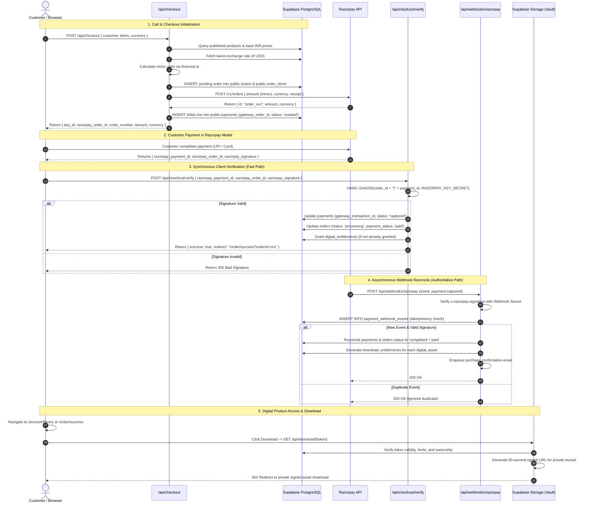
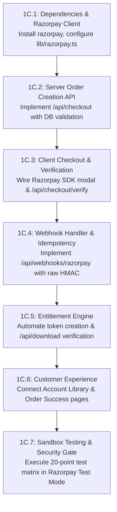

# SEVOLF DIGITAL — PHASE 1C
# RAZORPAY CHECKOUT ARCHITECTURE AUDIT

**Document Title:** `SEVOLF_PHASE_1C_RAZORPAY_ARCHITECTURE_AUDIT.md`  
**Project:** SEVOLF Digital Product Studio  
**Workspace:** `E:\Projects\Sevolf Digital`  
**Framework:** Next.js App Router (16.4.6, Turbopack) + TypeScript  
**Backend:** Supabase PostgreSQL (`kqoqdxoicqxulefnruvn`, Singapore, AWS `ap-southeast-1`)  
**Payment Gateway:** Razorpay Only (India First & Eligible Global)  
**Audit Date:** November 18, 2026  
**Status:** Audit Complete — Strictly Planning & Architecture Design (Zero Code / Schema Modifications)

---

## EXECUTIVE SUMMARY

Following the successful production deployment and operational verification of **Phase 1B (Pricing & Currency Engine)**, this architectural audit establishes the complete end-to-end payment and digital fulfillment design for **Phase 1C**.

The objective of Phase 1C is to bridge the verified database foundations with Razorpay's API and webhooks, allowing Indian and international customers to purchase digital PDF workbooks, frameworks, and tools securely, receiving immediate, verified access in their digital library with signed, time-limited download links.

This audit:
1. Conducts an exhaustive inspection of all existing Next.js App Router routes, components, contexts, and Supabase integration points.
2. Maps every checkout and fulfillment step to the deployed Phase 1B database schema without introducing duplicate commerce tables.
3. Formulates a strict, dual-channel reconciliation pattern (client verification + server-to-server webhook).
4. Establishes a zero-trust monetary calculation pipeline backed by `src/lib/financial.ts` with minor-unit integer arithmetic.
5. Designs a robust payment state machine preventing race conditions, double capture, and post-capture failure overwrites.
6. Details a 20-point sandbox testing matrix and a controlled 7-stage implementation roadmap.

---

## 1. EXISTING APPLICATION AUDIT & INVENTORY

Every relevant frontend, backend, context, and service component in the workspace was inspected and classified:

| Component / Layer | Workspace Path | Current State | Classification | Observations & Necessary Modifications |
| :--- | :--- | :--- | :---: | :--- |
| **Cart State** | `src/context/CartContext.tsx` | Active | **Partially Implemented** | Client-side cart provider with `localStorage` persistence and sanitization. Needs update to support server price re-verification and frozen rate snapshot handling. |
| **Cart Drawer UI** | `src/components/cart/CartDrawer.tsx` | Active | **Implemented** | Slide-out cart drawer with item count, line items, and checkout navigation button. |
| **Checkout Page UI** | `src/app/checkout/page.tsx` | Active | **Needs Modification** | Currently contains radio toggles for Razorpay and Stripe. Must remove Stripe completely (Razorpay-only decision), load Razorpay Checkout SDK (`https://checkout.razorpay.com/v1/checkout.js`), handle Razorpay modal response, and trigger verification API. |
| **Checkout API** | `src/app/api/checkout/route.ts` | Active | **Needs Modification** | Prototype stub that returns mock order IDs and includes Stripe checks. Needs rewrite to: (1) authenticate or create guest session, (2) fetch authoritative database prices, (3) calculate minor units via `financial.ts`, (4) insert pending row in `public.orders`, (5) call Razorpay Orders API (`orders.create`), (6) return `key_id`, `order_id`, `amount`, and `currency` to browser. |
| **Payment Verification API** | `src/app/api/checkout/verify/route.ts` | Non-existent | **Missing** | New route required to verify `razorpay_payment_id`, `razorpay_order_id`, and `razorpay_signature` via HMAC SHA256 before granting initial client completion response. |
| **Webhook Ingestion API** | `src/app/api/webhooks/razorpay/route.ts` | Non-existent | **Missing** | New route required to consume raw request buffer, verify `x-razorpay-signature` against `RAZORPAY_WEBHOOK_SECRET`, log event into `payment_webhook_events`, and idempotently trigger fulfillment. |
| **Download Entitlement API**| `src/app/api/download/[token]/route.ts` | Active | **Partially Implemented** | Validates token, checks expiry/limits, creates 60-second Supabase Storage signed URL, and records download log. Needs minor update: support guest email token authorization without mandatory Supabase auth cookie. |
| **Order Success Page** | `src/app/order/success/page.tsx` | Active | **Needs Modification** | Renders order confirmation and token links. Must query authoritative order and entitlements by verified order ID. |
| **Customer Library** | `src/app/account/library/page.tsx` | Active | **Needs Modification** | Currently displays hardcoded mock library items. Must query `download_entitlements` joined with `digital_assets` for authenticated customer. |
| **Orders History** | `src/app/account/orders/page.tsx` | Active | **Needs Modification** | Currently renders mock orders. Must query `public.orders` for authenticated user. |
| **Financial Engine** | `src/lib/financial.ts` | Active | **Implemented** | Tested decimal-safe integer minor-unit arithmetic, half-up rounding, and 6-decimal exchange rate scaling. Production-ready for Phase 1C. |
| **Currency Display** | `src/lib/currency.ts` | Active | **Needs Modification** | Hardcoded conversion rates (e.g. `0.012`). Must be updated to source active rates from `currency_exchange_rates` table or frozen order snapshots. |
| **Currency Context** | `src/context/CurrencyContext.tsx` | Active | **Implemented** | Manages client currency selection (INR/USD). |
| **Supabase Server Clients**| `src/lib/supabase/server.ts`, `admin.ts` | Active | **Implemented** | Cookie-based SSR client (`server.ts`) and privileged service-role admin client (`admin.ts`). Fully compatible. |
| **Email Infrastructure** | Workspace-wide | Non-existent | **Missing** | No transactional email provider (Resend/Postmark/SendGrid) is currently installed or configured. |
| **Razorpay SDK** | Workspace-wide | Non-existent | **Missing** | `razorpay` npm package is not installed; checkout route currently simulates gateway response. |

---

## 2. DATABASE MAPPING & REUSE ANALYSIS

Phase 1C **reuses 100% of the deployed Phase 1B database schema**. No new tables or schema migrations are required.

```
┌────────────────────────────────────────────────────────────────────────────────────────┐
│                               DATABASE ENTITY MAPPING                                  │
├──────────────────────────┬─────────────────────────────────────────────────────────────┤
│ Operation                │ Target Table & Columns Utilized                             │
├──────────────────────────┼─────────────────────────────────────────────────────────────┤
│ 1. Catalog Validation    │ public.products (id, slug, status, name)                   │
│                          │ public.product_prices (amount, currency, is_default)        │
│ 2. Order Creation        │ public.orders (                                             │
│    (Pending)             │   id, order_number, customer_email, customer_name,           │
│                          │   user_id, base_currency, base_amount,                      │
│                          │   charged_currency, charged_amount, exchange_rate_used,      │
│                          │   exchange_rate_source, exchange_rate_timestamp,            │
│                          │   subtotal, discount, total_amount,                         │
│                          │   status = 'pending', payment_status = 'unpaid'             │
│                          │ )                                                           │
│ 3. Line Item Snapshot    │ public.order_items (                                        │
│                          │   id, order_id, product_id, product_name,                   │
│                          │   quantity, unit_price, total_price                         │
│                          │ )                                                           │
│ 4. Payment Recording     │ public.payments (                                           │
│                          │   id, order_id, gateway = 'razorpay',                       │
│                          │   gateway_order_id, gateway_transaction_id,                  │
│                          │   amount, currency, status = 'created'|'captured'|'failed'  │
│                          │ )                                                           │
│ 5. Webhook Ledger        │ public.payment_webhook_events (                             │
│                          │   id, gateway = 'razorpay', event_id, event_type,           │
│                          │   status = 'received'|'processing'|'processed'|'failed',    │
│                          │   raw_payload, error_details, received_at, processed_at      │
│                          │ )                                                           │
│ 6. Digital Fulfillment   │ public.download_entitlements (                              │
│                          │   id, order_id, digital_asset_id, user_id, customer_email,  │
│                          │   token, download_limit, download_count, expires_at, is_active│
│                          │ )                                                           │
│ 7. Audit Logging         │ public.download_logs (                                      │
│                          │   id, entitlement_id, ip_address, user_agent, downloaded_at │
│                          │ )                                                           │
└──────────────────────────┴─────────────────────────────────────────────────────────────┘
```

### Schema Constraints Utilized
- `uq_payments_gateway_transaction`: Prevents duplicate payment capture records for the same Razorpay payment ID (`pay_xxx`).
- `uq_entitlements_order_asset`: Prevents accidental duplicate entitlement tokens for the same order and digital asset.
- `uq_webhook_events_gateway_event`: Prevents duplicate execution of identical webhook events (`x-razorpay-event-id`).
- `orders.base_amount`, `orders.charged_amount`, `orders.exchange_rate_used`: Provides an immutable audit trail of currency conversion at checkout.

---

## 3. PAYMENT & CURRENCY ARCHITECTURE

### 3.1 Domestic vs. International Rules
1. **Domestic Customers (India)**:
   - Currency: **INR (₹)**.
   - Pricing: Authoritative base price from `product_prices` where `currency = 'INR'`.
   - Gateway Unit: Integer paise (`amount * 100`).
   - Exchange rate recorded: `1.000000`.
   - Payment methods supported by Razorpay: UPI (Google Pay, PhonePe, Paytm, BHIM), Net Banking, RuPay/Visa/Mastercard Cards.
2. **International Customers (Global)**:
   - Currency: **USD ($)**.
   - Pricing: Derived from base INR price using the latest recorded rate from `currency_exchange_rates`.
   - Gateway Unit: Integer cents (`Math.round(base_amount * rate * 100)`).
   - Exchange rate recorded: Exact 6-decimal exchange rate (e.g. `0.011500`).
   - Payment methods supported by Razorpay: International Visa, Mastercard, American Express (subject to merchant international activation).
   - *EUR and GBP:* Display-only in Phase 1; checkout forced to USD or INR.

### 3.2 Immutability & Zero-Trust Enforcement
- **Browser Disregard**: The browser sends only `items: [{ productId, quantity }]` and preferred `currency`. The server fetches verified prices directly from Supabase.
- **Rate Freezing**: Once a pending order is created, the exchange rate is permanently written to `orders.exchange_rate_used`. Subsequent webhook captures or status updates read this frozen rate; they never query live rates.
- **Integer Minor Units**: All monetary values transmitted to Razorpay are strictly integers without floating-point fractions (`129900` paise, not `1299.00`).

---

## 4. COMPLETE END-TO-END CHECKOUT FLOW



---

## 5. RAZORPAY INTEGRATION SPECIFICATIONS

### 5.1 Server-Side Razorpay Order Creation
- **Endpoint**: `POST https://api.razorpay.com/v1/orders`
- **Authentication**: HTTP Basic Auth (`RAZORPAY_KEY_ID:RAZORPAY_KEY_SECRET`)
- **Payload**:
  ```json
  {
    "amount": 129900,
    "currency": "INR",
    "receipt": "ORD-20260218-001",
    "notes": {
      "supabase_order_id": "9b1deb4d-3b7d-4bad-9bdd-2b0d7b3dcb6d",
      "customer_email": "patron@sevolf.com"
    }
  }
  ```
- **Response Handling**: The resulting `id` (`order_xxxx`) is stored in `public.payments.gateway_order_id` and returned to the browser along with the public `RAZORPAY_KEY_ID`.

### 5.2 Signature Verification
The verification algorithm executes strictly server-side using Node.js native `crypto`:
```typescript
import crypto from "crypto";

export function verifyRazorpaySignature({
  orderId,
  paymentId,
  signature,
  secret,
}: {
  orderId: string;
  paymentId: string;
  signature: string;
  secret: string;
}): boolean {
  const body = `${orderId}|${paymentId}`;
  const expectedSignature = crypto
    .createHmac("sha256", secret)
    .update(body)
    .digest("hex");
  return crypto.timingSafeEqual(
    Buffer.from(expectedSignature),
    Buffer.from(signature)
  );
}
```

### 5.3 Webhook Ingestion & Raw Body Handling
- In Next.js App Router, the webhook route must access `request.text()` (raw body string) prior to JSON parsing.
- The raw body is passed to HMAC-SHA256 with `RAZORPAY_WEBHOOK_SECRET`:
  ```typescript
  const rawBody = await request.text();
  const signature = request.headers.get("x-razorpay-signature");
  const expectedSignature = crypto
    .createHmac("sha256", process.env.RAZORPAY_WEBHOOK_SECRET!)
    .update(rawBody)
    .digest("hex");
  ```
- **Idempotency Execution**: Every webhook event is inserted into `public.payment_webhook_events` with unique constraint `(gateway, event_id)`. If an identical event arrives, the database rejects the duplicate with error code `23505`, allowing the webhook route to return an immediate `200 OK` without re-running fulfillment.

### 5.4 Digital Entitlement Generation Rule
When a payment reaches `captured`:
1. Find all `digital_assets` linked to the purchased products in `order_items` via `product_digital_assets`.
2. Generate a secure, cryptographically random 32-byte hexadecimal token for each asset:
   `token = crypto.randomBytes(32).toString('hex')`.
3. Set `download_limit = 10` and `expires_at = NOW() + INTERVAL '365 days'`.
4. Insert into `public.download_entitlements` with `ON CONFLICT (order_id, digital_asset_id) DO NOTHING`.
5. Associate `user_id` if customer is authenticated; link `customer_email` for guest checkout.

---

## 6. PAYMENT STATE MACHINE

To prevent race conditions between the browser's synchronous callback and asynchronous webhooks, an explicit state machine governs `public.orders` and `public.payments`:

```
                       ┌──────────────┐
                       │  ORDER CREATED│ (orders: 'pending', payments: 'created')
                       └──────┬───────┘
                              │
               Customer initiates Razorpay modal
                              ▼
                       ┌──────────────┐
                       │ PAYMENT MODAL │
                       └──────┬───────┘
              ┌───────────────┴───────────────┐
              ▼                               ▼
      ┌───────────────┐               ┌───────────────┐
      │ PAYMENT FAILED │               │ PAYMENT CAPTURED│ (verify API or webhook)
      │ status: failed│               │ status: paid  │
      └──────┬────────┘               └───────┬───────┘
             │                                │
             ▼                                ▼
      Customer retries              ┌──────────────────┐
      with new transaction          │ENTITLEMENTS READY│
                                    │status: completed │
                                    └─────────┬────────┘
                                              │ (Optional / Merchant Initiated)
                                              ▼
                                    ┌──────────────────┐
                                    │ REFUND PROCESSED │
                                    │ status: refunded │
                                    └──────────────────┘
```

### Valid & Invalid State Transitions

| Current Order Status | Event Trigger | New Order Status | Allowed? | Enforcement Rule |
| :--- | :--- | :--- | :---: | :--- |
| `pending` | `payment.captured` | `completed` | **YES** | Standard happy path. Entitlements generated. |
| `pending` | `payment.failed` | `cancelled` | **YES** | Customer abandoned or card rejected. |
| `completed` | `payment.failed` | `cancelled` | **NO** | **Blocked.** Delayed failure event cannot overwrite confirmed capture. |
| `completed` | `refund.processed`| `refunded` | **YES** | Revokes entitlement (`is_active = false`). |
| `refunded` | Any payment event | Any | **NO** | **Blocked.** Terminal state. |

---

## 7. GUEST CHECKOUT & ACCOUNT LINKING ARCHITECTURE

### 7.1 The Threat Model
If an order or entitlement is linked solely to an unauthenticated email address, an attacker could supply a victim's email at checkout and claim access or spoof existing libraries.

### 7.2 Secure Guest Ownership Protocol
1. **At Checkout**:
   - The customer enters `email` and `fullName`.
   - The server creates the order with `customer_email = email` and `user_id = NULL`.
   - When payment succeeds, a unique, cryptographically random **Order Access Key** (UUID v4) is generated and stored in a new private column or encoded in the order success URL (`/order/success?orderId=xxx&accessKey=yyy`).
   - The browser can view the immediate success receipt and download files using the access key during that session.
2. **Account Linking on Registration / Login**:
   - When a guest subsequently registers or logs in with that same email address:
     - An automatic Supabase trigger or post-login reconciliation query links historical orders:
       ```sql
       UPDATE public.orders
       SET user_id = auth.uid()
       WHERE customer_email = (SELECT email FROM auth.users WHERE id = auth.uid())
         AND user_id IS NULL;

       UPDATE public.download_entitlements
       SET user_id = auth.uid()
       WHERE customer_email = (SELECT email FROM auth.users WHERE id = auth.uid())
         AND user_id IS NULL;
       ```
   - This automatically populates their **Digital Library** (`/account/library`) the moment their email is verified.

---

## 8. SECURITY & THREAT ASSESSMENT

| Threat Vector | Severity | Mitigation Architecture |
| :--- | :---: | :--- |
| **Payment Signature Tampering** | Critical | Server verifies `HMAC-SHA256(order_id + "\|" + payment_id, secret)` using constant-time string comparison (`crypto.timingSafeEqual`). |
| **Price / Amount Manipulation** | Critical | Client-supplied prices are completely ignored. Server queries `product_prices` and calculates exact payable minor units via `financial.ts`. |
| **Currency Switching Attack** | High | Order records frozen `charged_currency` and `exchange_rate_used`. Gateway payload strictly enforces this currency. |
| **Duplicate Webhook Replay** | High | Webhook table enforces `UNIQUE (gateway, event_id)`. Duplicates are caught and return immediate `200 OK` without re-processing. |
| **Unauthorized Asset Download** | Critical | Asset files reside in private Supabase bucket (`digital-products`). Direct access is blocked. Downloads require `/api/download/[token]` which checks expiry and generates a 60-second signed URL. |
| **Service-Role Key Leakage** | Critical | `SUPABASE_SERVICE_ROLE_KEY` and `RAZORPAY_KEY_SECRET` are never referenced in client components (`"use client"`) or prefixed with `NEXT_PUBLIC_`. |
| **Download Token Guessing** | High | Tokens are 256-bit cryptographically secure random values (64 hex characters), rendering brute force mathematically impossible. |

---

## 9. EMAIL & CUSTOMER NOTIFICATIONS

### 9.1 Infrastructure Finding
- The workspace currently has **zero transactional email libraries** installed.
- There are no API keys for email delivery (e.g. Resend, Postmark, AWS SES) in `.env.local`.

### 9.2 Recommendation for Phase 1C
- Install **Resend** (`resend` npm package) or utilize Supabase Auth email webhooks.
- Provide responsive, elegant HTML transactional emails conforming to SEVOLF Digital's minimalist editorial design:
  1. **Order Confirmation & Digital Download Links**: Sent immediately upon `payment.captured`.
  2. **Payment Failure Notice**: Sent if payment is declined, with a secure link to retry checkout.
  3. **Refund Notification**: Sent if a refund is processed by admin.

---

## 10. RAZORPAY ACCOUNT READINESS & CREDENTIAL AUDIT

Inspection of `.env.local` without printing secrets revealed:

| Environment Variable | Configured in `.env.local`? | Value Status | Readiness Verdict |
| :--- | :---: | :---: | :--- |
| `RAZORPAY_KEY_ID` | Yes | **EMPTY** | Must be populated with Razorpay Test Key (`rzp_test_...`) |
| `RAZORPAY_KEY_SECRET` | Yes | **EMPTY** | Must be populated with Razorpay Test Secret |
| `RAZORPAY_WEBHOOK_SECRET` | Yes | **EMPTY** | Must be configured when setting up test webhook endpoint |
| `NEXT_PUBLIC_STRIPE_PUBLISHABLE_KEY` | Yes | Empty | **Obsolete**: Stripe keys will not be used |
| `STRIPE_SECRET_KEY` | Yes | Empty | **Obsolete**: Stripe keys will not be used |

### Merchant Account Prerequisites for Razorpay
1. **Domestic Payments (INR)**: Standard Razorpay account verification (KYC/business bank account in India). Supports UPI, Cards, NetBanking out of the box in test mode.
2. **International Payments (USD)**: Requires explicit activation by Razorpay Risk Operations. Merchants must have an IEC (Import Export Code) or qualify under digital services export regulations to accept non-INR transactions.
3. **Phase 1C Strategy**: Conduct test mode verification with INR first; configure USD test orders to verify system currency handling while awaiting international gateway approval.

---

## 11. REQUIRED API ROUTE SPECIFICATIONS

### 11.1 `POST /api/checkout`
- **Purpose**: Creates pending Supabase order and registers Razorpay Order.
- **Auth**: Optional (Guest or Authenticated Customer).
- **Request Body**:
  ```json
  {
    "customer": { "email": "string", "fullName": "string", "country": "string" },
    "items": [{ "productId": "uuid", "quantity": 1 }],
    "currency": "INR" | "USD"
  }
  ```
- **Validation**:
  - Validates email syntax.
  - Queries `products` for `status = 'published'`.
  - Queries `product_prices` for active price.
  - Calculates amounts via `calculateOrderAmounts()` in `financial.ts`.
- **Database Action**: Inserts `public.orders` (`pending`) and `public.order_items`.
- **Gateway Action**: Calls `razorpay.orders.create({ amount, currency, receipt })`.
- **Response**:
  ```json
  {
    "success": true,
    "keyId": "rzp_test_xxx",
    "razorpayOrderId": "order_xxx",
    "orderNumber": "ORD-20260218-001",
    "amount": 129900,
    "currency": "INR"
  }
  ```

### 11.2 `POST /api/checkout/verify`
- **Purpose**: Client payment completion verification.
- **Auth**: Public / Client.
- **Request Body**:
  ```json
  {
    "razorpayOrderId": "order_xxx",
    "razorpayPaymentId": "pay_xxx",
    "razorpaySignature": "hex_string",
    "orderNumber": "ORD-xxx"
  }
  ```
- **Validation**:
  - Computes HMAC-SHA256 of `razorpayOrderId + "|" + razorpayPaymentId`.
  - Validates equality with `razorpaySignature`.
- **Database Action**:
  - Updates `public.payments` to `captured`.
  - Updates `public.orders` to `completed` and `payment_status = 'paid'`.
  - Generates `download_entitlements` tokens for each digital asset.
- **Response**: `{ "success": true, "redirectUrl": "/order/success?orderNumber=ORD-xxx" }`.

### 11.3 `POST /api/webhooks/razorpay`
- **Purpose**: Server-to-server authoritative payment event reconciliation.
- **Auth**: Webhook signature verification via `x-razorpay-signature`.
- **Request Body**: Raw JSON payload from Razorpay.
- **Handling**:
  - Logs event to `payment_webhook_events`.
  - On `payment.captured`: Reconciles order to `completed`, ensures entitlements exist.
  - On `payment.failed`: Records error, updates payment to `failed`.
  - On `refund.processed`: Sets order to `refunded`, revokes entitlements (`is_active = false`).
- **Response**: `{ "status": "ok" }`.

### 11.4 `GET /api/download/[token]`
- **Purpose**: Protected time-limited digital asset streaming.
- **Auth**: Token validity and ownership.
- **Validation**: Token exists, `is_active = true`, `expires_at > NOW()`, `download_count < limit`.
- **Database Action**: Records audit log in `public.download_logs`, increments `download_count`.
- **Storage Action**: Generates 60-second signed URL on `digital-products` bucket.
- **Response**: `302 Redirect` to signed URL.

---

## 12. SANDBOX TESTING MATRIX (20 CASES)

| # | Test Scenario | Input / Action | Expected Result |
| :---: | :--- | :--- | :--- |
| **01** | Domestic INR Checkout | 1 Product, INR selected, UPI payment | Order `completed`, 1 payment `captured`, entitlement created. |
| **02** | International USD Checkout | 1 Product, USD selected, Card payment | Frozen exchange rate in order, minor units in cents, payment `captured`. |
| **03** | Multi-Item Cart Checkout | 2 Products, INR selected | Correct sum in minor units, entitlements created for all assets. |
| **04** | Payment Modal Dismissal | Customer closes Razorpay popup | Order remains `pending`, payment marked `created`, no entitlements. |
| **05** | Card Declined | Invalid CVV or insufficient funds in test card | `payment.failed` event logged, order remains `pending`/`cancelled`, zero access. |
| **06** | Signature Tampering | Altered `razorpay_signature` in verify request | Verify API returns 400 Bad Signature, order is NOT marked paid. |
| **07** | Duplicate Verify Call | Browser re-triggers `/api/checkout/verify` | Idempotent response, does not create duplicate payment rows or entitlements. |
| **08** | Webhook Arrives First | Webhook fires before browser verify completes | Webhook marks order `completed`, verify API succeeds cleanly without duplicate insert. |
| **09** | Duplicate Webhook Delivery | Razorpay delivers `payment.captured` twice | Second event rejected by `uq_webhook_events_gateway_event`, returns 200 OK. |
| **10** | Invalid Webhook Signature | Fake webhook request sent to webhook endpoint | Returns 400 Unauthorized, event is not processed. |
| **11** | Price Tampering in Browser | Altered price in checkout request | Server queries database; client price is ignored; exact DB price charged. |
| **12** | Currency Switching | Order created in INR, client attempts USD verify | Verified against order record; rejected if currency mismatches. |
| **13** | Unpublished Product Checkout| Product changed to `draft` before checkout | Checkout API returns 400 "Product is unpublished". |
| **14** | Zero Price / Unapproved | Product price record deleted or set to 0 | Checkout API returns 400 "Pricing unapproved". |
| **15** | Valid Token Download | Click download link with valid token | 302 Redirect to signed URL, download count incremented, log written. |
| **16** | Expired Token Download | Download after `expires_at` | 410 Gone: "Download link has expired". |
| **17** | Download Limit Exceeded | Download 11 times when limit is 10 | 429 Too Many Requests: "Download limit reached". |
| **18** | Guest Account Linking | Guest registers with same email | Historical orders and library automatically link to new `user_id`. |
| **19** | Refund Revocation | Admin issues refund in Razorpay | `refund.processed` sets `is_active = false`; subsequent downloads blocked. |
| **20** | Storage Vault Direct Access | Direct HTTP request to Supabase Storage bucket | 403 Forbidden (private bucket security verified). |

---

## 13. PROPOSED WORKSPACE FILE STRUCTURE

```
src/
├── app/
│   ├── api/
│   │   ├── checkout/
│   │   │   ├── route.ts            # Order creation & Razorpay order init
│   │   │   └── verify/
│   │   │       └── route.ts        # Fast-path signature verification
│   │   ├── webhooks/
│   │   │   └── razorpay/
│   │   │       └── route.ts        # Authoritative webhook processing
│   │   └── download/
│   │       └── [token]/
│   │           └── route.ts        # Protected asset download endpoint
│   ├── checkout/
│   │   └── page.tsx                # Razorpay-only checkout client
│   ├── order/
│   │   └── success/
│   │       └── page.tsx            # Confirmed receipt & immediate access
│   └── account/
│       └── library/
│           └── page.tsx            # Authenticated digital library
├── lib/
│   ├── financial.ts                # (Active) Minor-unit calculations
│   ├── razorpay.ts                 # (New) Razorpay SDK client & signature helpers
│   └── email.ts                    # (New) Transactional email dispatch
└── services/
    └── checkout/
        ├── orderService.ts         # Server-side order operations
        └── entitlementService.ts    # Token generation & asset granting
```

---

## 14. PHASE 1C IMPLEMENTATION ROADMAP

The implementation of Phase 1C should proceed through seven controlled, verifiable stages:



### Stage Details

#### Stage 1C.1 — Dependencies & Gateway Client
- **Action**: Install `razorpay` npm package and types.
- **Files**: Create `src/lib/razorpay.ts`.
- **Validation**: Verify server initialization with `RAZORPAY_KEY_ID` and `RAZORPAY_KEY_SECRET`.

#### Stage 1C.2 — Order Creation API
- **Action**: Rewrite `src/app/api/checkout/route.ts` to validate published status, query authoritative prices, freeze exchange rates, write pending rows to `public.orders`, and call `razorpay.orders.create`.
- **Files**: `src/app/api/checkout/route.ts`, `src/services/checkout/orderService.ts`.

#### Stage 1C.3 — Client Checkout & Fast-Path Verification
- **Action**: Remove Stripe toggles from `src/app/checkout/page.tsx`. Embed Razorpay checkout script, launch modal on submission, and submit payment response to `/api/checkout/verify`.
- **Files**: `src/app/checkout/page.tsx`, `src/app/api/checkout/verify/route.ts`.

#### Stage 1C.4 — Webhook Processing Engine
- **Action**: Create `src/app/api/webhooks/razorpay/route.ts`. Verify raw body signature, insert into `payment_webhook_events`, handle duplicate deliveries, and update order status.
- **Files**: `src/app/api/webhooks/razorpay/route.ts`.

#### Stage 1C.5 — Entitlement Generation & Download Security
- **Action**: Implement digital asset token creation linked to `digital_assets`. Connect to `/api/download/[token]` with signed URLs.
- **Files**: `src/services/checkout/entitlementService.ts`, `src/app/api/download/[token]/route.ts`.

#### Stage 1C.6 — Customer Library & Order Success
- **Action**: Connect `src/app/account/library/page.tsx` and `src/app/order/success/page.tsx` to read real user entitlements and orders from Supabase.
- **Files**: `src/app/account/library/page.tsx`, `src/app/order/success/page.tsx`.

#### Stage 1C.7 — Sandbox Testing & Security Gate
- **Action**: Execute the 20-scenario testing matrix in Razorpay Test Mode. Audit HMAC verification, database idempotency, and production build.

---

## 15. RISKS, DEPENDENCIES & OPEN DECISIONS

1. **Razorpay International (USD) Capability**:
   - *Dependency*: Razorpay international card support must be activated by Razorpay compliance for live merchant accounts.
   - *Mitigation*: The Phase 1C architecture is built currency-agnostic; it fully supports USD testing in test mode and gracefully defaults to INR for domestic checkout.
2. **Transactional Email Service**:
   - *Decision Required*: User must confirm preferred email provider (Resend, Postmark, AWS SES, or Supabase Auth SMTP) before Stage 1C.6.
3. **Product Pricing & Publication**:
   - Both launch products (`14-day-home-reset-kit` and `mitthus-fun-learning-book`) remain strictly in `draft` with 0 prices. Testing in sandbox will require creating test pricing records or a dedicated test product.

---

## 16. AUDIT CONCLUSION & READINESS VERIFICATION

- **Database Readiness**: **100% Ready** (Phase 1B schema fully deployed and verified).
- **Financial Logic**: **100% Ready** (`financial.ts` verified with minor units).
- **Codebase Readiness**: **Clean** (Build passes cleanly with 34 routes).
- **Action Policy**: **Zero modifications made during this audit.**

**Next Action**: Awaiting user approval of this architecture document to begin **Stage 1C.1 Implementation Planning**.
